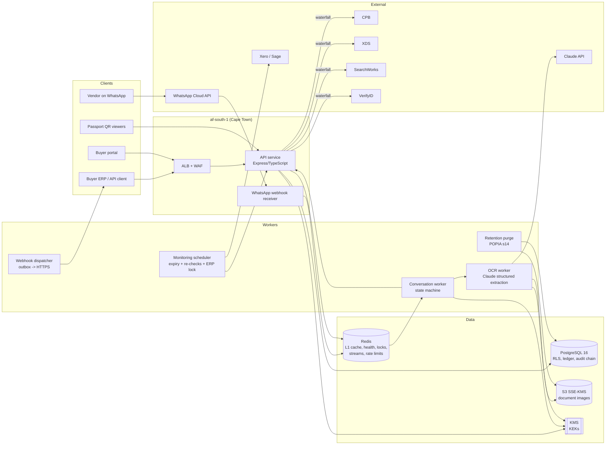
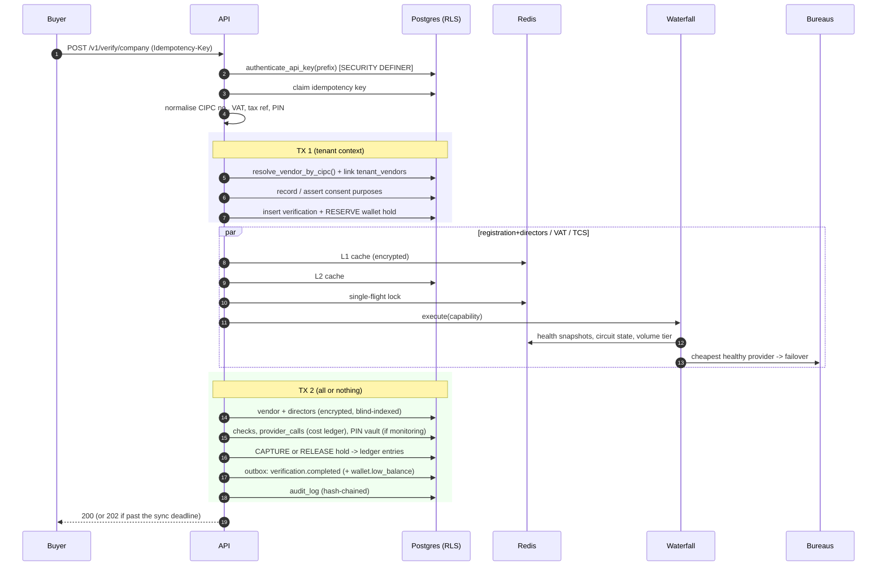

# 1. System architecture and the waterfall API engine

## 1.1 Design goals (in priority order)

1. **Unit margin at R3.00 per check.** Every design choice is judged by its effect on the cost of a check: caching, request coalescing, prepaid bureau bundles, cost-aware routing, and not charging for our own outages.
2. **POPIA by construction.** Tenant isolation is enforced in the database, identifiers are encrypted with blind indexes, the cache scope is decided by the data, and deletion is automatic.
3. **Correctness under failure.** Holds instead of locks, a transactional outbox, idempotency keys, circuit breakers, and stale-if-error with explicit flags.
4. **One codebase for API, portal, WhatsApp and monitoring.** Every channel calls the same verification services.

## 1.2 Component view



| Component | Code | Notes |
|---|---|---|
| API service | `src/app.ts`, `src/routes/*` | Stateless. Holds no tenant context between requests; RLS context is set per transaction (`SET LOCAL`). |
| Waterfall engine | `src/waterfall/engine.ts`, `src/waterfall/health.ts` | Cost- and uptime-aware routing, circuit breakers, upstream-outage detection. |
| Provider adapters | `src/providers/adapters/*` | One canonical model per capability. Bureau-specific mapping is isolated and pure. |
| Tiered cache | `src/cache/verificationCache.ts` | Redis L1 and Postgres L2, both encrypted. The scope (global or tenant) is decided by the type of data. |
| Check resolver | `src/services/checkResolver.ts` | cache -> single-flight -> waterfall -> stale-if-error |
| Verification services | `src/services/companyVerification.ts`, `driverLicenceVerification.ts` | Validation, consent, reserve, run, evaluate, finalise. |
| Billing | `src/billing/wallet.ts` | Reserve/capture/release over a double-entry ledger. |
| Webhooks | `src/webhooks/*` | Transactional outbox, Stripe-style signatures, a dispatcher using SKIP LOCKED. |
| WhatsApp | `src/whatsapp/*` | Webhook receiver, a **pure** state machine and an action-executing worker. |
| OCR | `src/ocr/*` | Claude vision with structured outputs, then deterministic post-validation. |
| Retention | `src/workers/retentionPurge.ts`, `run_retention_purge()` | Crypto-shredding plus deletion of object-store images. |

## 1.3 Request lifecycle: `POST /v1/verify/company`



Some properties follow from this structure:

* **No charge without delivery.** The hold is captured only when the primary check returns a definitive answer. "Company does not exist" counts as definitive and is billed. A bureau outage is not billed.
* **No delivery without a record.** Results, billing, webhook and audit entry commit in one transaction (TX 2).
* **A wallet row is never locked during a bureau call.** The hold is a single atomic `UPDATE ... WHERE balance - held + credit_limit >= amount`, and the `wallet_no_overspend` CHECK constraint is the final guard.
* **Retries are safe.** The idempotency key replays the stored response, and the capture is keyed `capture:<hold_id>` in the ledger.

## 1.4 The waterfall router

### Capabilities, not bureaus

Callers ask for a **capability** (`company_registration`, `vat_status`, `tax_compliance_status`, `driver_licence`, `id_verification`). Bureaus bundle data differently. Most return directors with the company enquiry, and PrDP usually comes with the licence record, so bundled data is modelled inside the parent capability's output. `provider_capabilities` holds the contracted wholesale price, volume tiers, any prepaid bundle balance, the timeout, and whether the provider is a **live source** (it queries CIPC or eNaTIS in real time) or serves a **cached copy**.

### Scoring: expected cost, not list price

For every candidate:

```
score = marginal_price                                  // 0 while a prepaid bundle has units (sunk cost)
      + 150c × (1 − success_rate)                       // a failure costs a retry and latency
      + 10c  × ewma_latency_seconds                     // user-facing latency has a price
      + 500c × (needs_live_data ∧ ¬is_live_source)      // new companies, freshness=live
```

* `success_rate` is computed over the last 50 calls with a Beta(4,1) prior, so a new provider starts at an assumed 80% and is not starved of traffic.
* `marginal_price` uses the volume tier reached by month-to-date volume, read from a Redis counter. Moving the marginal call to whichever bureau's tier break is closest is free margin.
* The constants live in `SCORING` and are deliberately simple. Tune them from `provider_calls` data, which holds the outcome, latency and cost of every attempt.

### Execution rules

| Rule | Why |
|---|---|
| **Cost ceiling per request.** The default company ceiling is R2.40, split 65/20/15% across registration, VAT and TCS. | Stops a cascade of failures from turning a R3.00 sale into a R9.00 cost. When the budget is exhausted the result is `unavailable`, which triggers stale-if-error and no charge. |
| **Overall deadline.** Each attempt gets `min(timeout, remaining)`. | A sync API has a latency budget, and we never start an attempt with less than 250 ms left. |
| **Circuit breaker per provider and capability.** It opens after 5 consecutive failures or ≥50% failures over 20 calls. The cooldown is 30 s, doubling to 5 min, and the half-open state sends one probe. | State is shared through Redis, so all instances stop hammering a dead bureau at once. |
| **4xx does not count against health.** | A rejected request is our fault, not the bureau's. |
| **Not-found confirmation.** A "not found" from a cached-copy bureau for a number captured this year or last year is confirmed with a live source. | Bureau copies of CIPC lag. Reporting "fake company" for a company registered last week is the worst possible false positive. CIPC Notice 1 of 2026 also confirms that the year in the number can precede the incorporation year. |
| **Upstream-outage detection.** If two or more providers fail on the same capability within 60 s, the capability is marked degraded. | CIPC, eNaTIS and eFiling have their own outages, and every bureau that proxies them fails together. Without this rule a request would pay for a tour of every bureau. While degraded, requests go straight to stale-if-error, 10% of requests probe, and `freshness=live` bypasses the rule. |

### Adding a bureau

1. Sign the contract **and a POPIA s21 operator agreement**, then record its date in `providers.operator_agreement_signed_on`.
2. Add a `BureauSpec` in `src/providers/adapters/httpBureau.ts`: `request()` and `map()` per capability. Unit-test `map()` against anonymised recorded fixtures.
3. Insert `provider_capabilities` rows with the contracted price, tiers and prepaid units, then add the code to `ENABLED_PROVIDERS`.

> The bureau endpoint paths and field names in `httpBureau.ts` are **placeholders**. Bureau APIs are contract-gated, and nothing here claims to reflect XDS, CPB, SearchWorks or VerifyID schemas. Confirm each bureau's product list before assuming it offers a capability. TCS and eNaTIS access in particular are not universal (see §1.7 and [doc 3](03-popia-sars-compliance.md#3-sars-tcs-pin-handling)).

## 1.5 POPIA-compliant caching

### Scope is decided by the data

| Capability | Scope | Fresh | Stale-if-error | Not-found TTL | Rationale |
|---|---|---|---|---|---|
| `company_registration` (incl. directors) | **global** | 7 days | +30 days | 6 h | Public register (CIPC, Companies Act 71 of 2008). Reuse across buyers is compatible further processing (POPIA s15), and collection from a public record is permitted (s12(2)(a)). |
| `vat_status` | **global** | 7 days | +30 days | 6 h | SARS VAT vendor search is public. |
| `tax_compliance_status` | **tenant** | 24 h | none | 1 h | Disclosed by the taxpayer to *one* buyer via the PIN. A stale "compliant" is worse than "unknown". |
| `driver_licence` | **tenant** | 24 h | none | 1 h | A natural person's record, disclosed for one engagement. |
| `id_verification` | **tenant** | 30 days | none | 1 h | DHA data. |

A vendor can choose to share its tenant-scoped results with another buyer through the **Verified Vendor Passport** (`vendor_passport_shares`). That is a separate flow based on the vendor's consent, with TshepoVet as the responsible party, and it never happens through the cache.

### Mechanics

* **Keys** are `HMAC(cache_key_key[scope], capability|subject)`. They are tenant-keyed for tenant scope, so a cache key for one tenant cannot be computed or matched for another.
* **Values** are AES-256-GCM envelope-encrypted. The AAD is `cache:<capability>:<scope>:<tenant>`, so neither a Redis dump nor a DB snapshot exposes director ID numbers.
* **Freshness control.** `freshness: live` bypasses the cache and is billed as `COMPANY_CHECK_LIVE`. `max_age_seconds` lets a buyer require recency without paying for live data. Every check reports `source`, `data_as_of` and `stale`.
* **Single-flight.** Concurrent identical lookups share one bureau call: an in-process promise map plus a cross-instance Redis lock, with losers polling L1. A 5,000-row CSV upload containing the same supplier 40 times costs one bureau fee. The followers record zero cost.
* **Negative caching.** Typos in bulk uploads do not trigger repeated paid lookups.
* **Purge.** `purge_after = stale_until`, and `run_retention_purge()` deletes expired L2 rows. L1 TTLs equal the stale horizon.

## 1.6 Unit economics

This is a worked model, not a quote. Replace the bureau costs with your contracted rates. `provider_calls.cost_cents` and `verifications.bureau_cost_cents` give you the real figures per check from day one.

```
cost_per_check ≈ (1 − h) · C_bureau + C_infra + C_kms + p_fail · C_retry
```

| Assumption | Value |
|---|---|
| Blended bureau cost per company enquiry, miss path (`C_bureau`) | R4.00 (illustrative) |
| Infra + KMS + Redis per check | R0.05 |
| Target gross margin on a R3.00 check | ≥ 50% → cost ≤ R1.50 |

Break-even hit rate for a 50% margin: `(1 − h) · 4.00 + 0.05 ≤ 1.50`, so **h ≥ 64%**.

How the product reaches that hit rate:

1. **The passport network effect.** Supplier overlap between buyers in the same metro and sector is high, and every passport makes the next buyer's check a hit.
2. **Monitoring re-checks are cache-aware.** Re-check at `fresh_until`, not on a timer per tenant: one refresh serves all tenants.
3. **Prepaid bundles and tier routing.** The router burns sunk-cost units first and pushes volume towards the next tier break.
4. **A `COMPANY_CHECK_LIVE` SKU (R6.00)** makes buyers who demand freshness pay for it.

Two cost lines do **not** fit inside R3.00 and should be priced or bundled deliberately:

* **TCS verification.** There is no public SARS API (see doc 3). If fulfilment is assisted (an eFiler checks the PIN) or bought from a bureau at a premium, either bundle TCS only into `MONITORING_PER_VENDOR` at R15/month, or add a TCS surcharge. The code already separates the TCS cost budget (15% of the ceiling) so the effect on margin is visible.
* **LLM OCR on onboarding**, roughly R0.50–R1.00 per document. That assumes about 3k input tokens (image, prompt and schema) and 1–2k output tokens including adaptive thinking, at Claude Opus 5.5 list prices of $4/$20 per MTok. Log `usage` per job and measure it. It is a one-off per vendor, amortised across every buyer through the passport. A cheaper first-pass model is a lever only if an eval on real SA documents shows field accuracy holds.

## 1.7 Module notes

* **Continuous monitoring and accounting lock (R15/vendor/month).** `monitoring_enrolments` uses an exclusion constraint, so a vendor can't be billed twice. `expiry_schedules` drives T-30/T-14/T-7/T-0 reminders, then `expire` and `lock` after `ref_document_types.lock_grace_days`. On `lock`, the ERP adapter applies the closest available control and emits `vendor.payment_locked`. Neither Xero nor Sage Business Cloud exposes a universal "payment block" flag through its API, so the realistic controls are: archive or tag the contact (Xero contact groups), set the supplier to inactive or on hold where the product supports it (Sage 200 Evolution and Sage Intacct have supplier hold settings), and run a pre-payment-batch check through our API. Document whichever control is used per connector, because buyers will ask whether the lock is truly blocking.
* **B-BBEE scorecard (R5,000/month).** It is built on `vendor_bbbee_profiles`, with recognition levels and thresholds as data and the `is_51pct_black_owned` and `is_30pct_black_female_owned` generated columns. The Preferential Procurement indicators of the Amended Codes (total measured procurement spend (TMPS)-weighted spend with all Empowering Suppliers, QSEs, EMEs, ≥51% black-owned and ≥30% black-women-owned suppliers, plus the designated-group bonus) are aggregations over AP spend joined to these profiles. Sector-code thresholds must be loaded from the gazettes with `verified=true` before automatic classification is allowed.
* **COI and ghost-supplier radar (R3,500/month).** HR identifiers are blind-indexed with a **tenant-specific key** (`tenant_employees`). The worker projects vendor director IDs, bank accounts, phone numbers and addresses into `coi_vendor_index` with the same tenant key, so matching is a tenant-local equi-join and identifiers cannot be linked across tenants (see the s57 analysis in doc 3). Fuzzy name plus address matching uses `pg_trgm`.
* **Industry add-ons.** CIDB grading (grade 1–9 + class of works, e.g. `7GB PE`) and COIDA Letters of Good Standing live in `vendor_credentials`. In construction, letters of good standing can come from the Compensation Fund or a licensed mutual such as FEM, so store `issuer`. Driver licences and PrDP use the same table and the logistics add-on gates `required_codes`/`required_prdp` workflows.

## 1.8 Security architecture

| Control | Implementation |
|---|---|
| Tenant isolation | Postgres RLS with `FORCE ROW LEVEL SECURITY` on every tenant table. The API connects as a non-superuser in `tshepovet_app`. Context is set with `SET LOCAL app.tenant_id` inside each transaction. Cross-tenant entity resolution goes through `SECURITY DEFINER` functions that return IDs only. |
| Encryption at rest | AES-256-GCM envelope encryption with a per-record DEK wrapped by a versioned KEK (KMS in production), AAD bound to table, column and row context. Disk/RDS encryption sits underneath. |
| Searchable identifiers | HMAC blind indexes, HKDF-derived per purpose, optionally per tenant. |
| API keys | 256-bit random, stored as `HMAC(pepper, key)`, looked up by public prefix, compared in constant time, scoped (`verify:write`, `verify:read`), and split live/test. Test keys can only reach the mock provider. |
| Audit | Append-only (`UPDATE`/`DELETE` revoked, plus a trigger), hash-chained per tenant with a contiguous `chain_seq` assigned under a per-tenant row lock. `verify_audit_chain()` detects edits and deletions. |
| Ledger | Immutable entries, a deferred constraint trigger that forces each transaction to sum to zero, and a CHECK constraint against overspend. |
| Logging | pino with redaction paths. The code logs references, never values. Logs are assumed to leave South Africa, which makes them a POPIA s72 concern. |
| Data residency | AWS `af-south-1` (Cape Town) for compute, DB, cache, object storage and KMS. Cross-border processors (LLM, observability SaaS) are listed in `processing_activities` with their s72 basis. |

## 1.9 Production hardening still to do

These limitations exist in the current code:

* **Async verifications run in-process.** A crash mid-flight is covered (holds expire after 15 minutes and the purge job marks the verification `unable_to_verify`), but production should move `process()` onto a durable queue (SQS or BullMQ) with the existing function as the handler.
* **KMS provider.** `LocalKeyProvider` is for development and test. Implement `KeyProvider` with AWS KMS `GenerateDataKey`/`Decrypt` plus DEK caching.
* **Partitioning.** `audit_log` is partitioned monthly. Partition `provider_calls` and `verification_checks` the same way once they pass about 50M rows.
* **Secure TCS link endpoint and WhatsApp Flow handler.** These are designed in doc 4 but not implemented.
