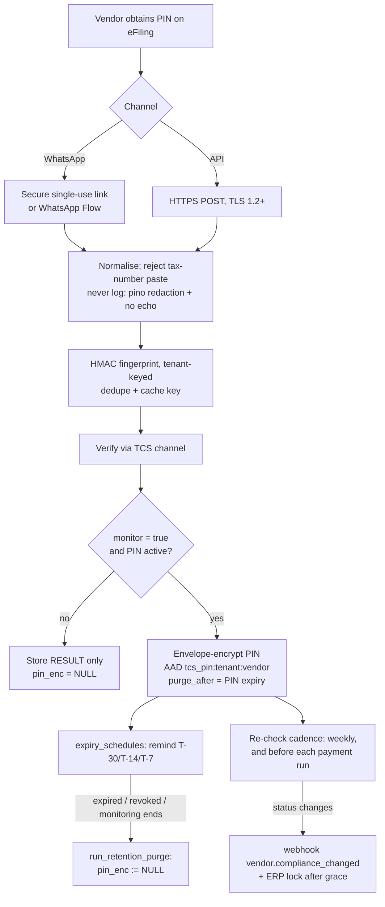

# 3. POPIA, SARS and FICA compliance workflow

> This is an engineering-grade compliance design, not legal advice. Section references are to the Protection of Personal Information Act 4 of 2013 (POPIA) unless stated otherwise. Have South African privacy counsel review the **roles matrix (§3.1)**, the **s57 assessment (§3.6)** and the **notice wording** (`privacy_notices`) before launch.

## 3.1 Who is who: roles decide obligations

POPIA protects **juristic persons as well as natural persons** (s1, "data subject"), so a supplier company's own details are personal information, not just its directors' details. TshepoVet plays two different roles:

| Processing | Responsible party (decides purpose) | Operator (processes on instruction) | Data subjects |
|---|---|---|---|
| Buyer onboards a supplier (API, portal, WhatsApp invite) | **Buyer (tenant)** | TshepoVet; bureaus as sub-operators or third-party sources | supplier entity, directors, representative, drivers |
| Verified Vendor Passport (vendor-owned profile shared with other buyers) | **TshepoVet** (the vendor instructs sharing) | n/a | supplier entity + its people |
| Global public-register cache (CIPC, VAT status) | **TshepoVet** (own legitimate interest; collected from a public record, s12(2)(a)) | AWS (hosting) | supplier entity, directors |
| COI / ghost-supplier radar | **Buyer** | TshepoVet | buyer's employees, vendor directors |
| LLM OCR | Buyer (onboarding) or TshepoVet (passport) | Anthropic (operator, s20/21) | person on the document |

Contracts follow from this table:

* **Buyer ↔ TshepoVet:** a s21 operator agreement in the MSA, covering security measures, breach notification to the buyer "immediately" (s21(2)), sub-operator list, and deletion on termination.
* **TshepoVet ↔ each bureau, Anthropic, AWS, Meta:** written operator or data-processing agreements. `providers.operator_agreement_signed_on` should block enabling a provider until it is populated (add that check to your release gate).
* **Passport terms of use** with the vendor, since TshepoVet is the responsible party there.

## 3.2 Lawful basis per processing activity (s11)

Consent is the weakest basis operationally because it can be withdrawn at any time (s11(2)(b)) and the burden of proof is on the responsible party (s11(2)(a)). Use it where it is genuinely needed:

| Activity | Basis | Why | Enforced in code |
|---|---|---|---|
| CIPC registration, status, directors | s11(1)(f) legitimate interest of the buyer, plus s18 notice | Due diligence before contracting and paying; public register | No consent required unless `tenants.settings.require_consent_for_all_checks` |
| VAT vendor status | s11(1)(f) | Public SARS search; needed for valid tax invoices (VAT Act s20) | none |
| SARS TCS via PIN | **s11(1)(a) consent** | The PIN is the taxpayer's own disclosure, made voluntarily to a specific buyer | `tax_compliance_verification` purpose asserted (`422 consent_required`) |
| Continuous monitoring | **consent** | Ongoing processing beyond the original transaction; also a paid add-on | `continuous_monitoring` purpose |
| Driver licence / PrDP | **consent of the driver** | A natural person not party to the buyer's contract. Employer attestation is allowed with evidence (`on_behalf_of_subject`) | Always required. A mismatch between the consent subject and the ID gives `consent_subject_mismatch` |
| B-BBEE ownership data | s11(1)(c) legal obligation / s11(1)(f), **plus s29(b)** for race | See §3.4 | `special_pi_basis = 's29_bbbee_redress'` |
| Document OCR (images) | consent (onboarding flow) | Involves biometric-adjacent images and cross-border processing | `document_ocr_processing` (+ `cross_border_processing`) |
| COI radar | s11(1)(f) legitimate interest of the buyer (fraud prevention; for public-sector buyers, PFMA/MFMA duties) | Needs a legitimate-interest assessment per tenant, plus an employee privacy notice | tenant-keyed blind indexes |
| WhatsApp service messages | consent (opt-in) | Meta policy; ECTA s45 / CPA s11 for anything promotional | `whatsapp_service_messages` |
| Direct marketing to vendors | **s69 opt-in consent** | Unsolicited electronic marketing needs prior consent | separate `direct_marketing` purpose, never bundled |

## 3.3 Consent capture: step-by-step

### A. Inline API attestation (buyer captured consent in its own process)

1. **Notice.** The buyer shows the data subject the TshepoVet-provided notice text (`privacy_notices.code = company_verification | driver_verification`). Notices are versioned and immutable, and `body_sha256` is the hash of the exact text.
2. **Capture.** The buyer records the subject's agreement (signed form, e-sign, portal checkbox) and keeps the evidence.
3. **Attest.** The API request carries `consent: {notice_code, subject_display, subject_role, on_behalf_of_subject, purposes[], captured_at, evidence_reference, attested_by}`.
4. **Record.** `ConsentService.recordAttestation()` resolves the active notice version and stores a `consent_records` row with `capture_method='api_attestation'`, the evidence JSON, the API key that attested, and `evidence_sha256 = sha256(canonical(evidence) ‖ notice_hash)`. That hash is tamper evidence over both what was agreed and the text agreed to.
5. **Granular purposes.** One `consent_purposes` row per purpose, each with its own lawful basis. Purposes can be withdrawn individually.
6. **Assert.** Before reserving funds, `assertPurposes()` checks that the consent belongs to the tenant, is not expired, and covers every purpose the request needs. If not, the response is `422` with `missing_purposes` and nothing is charged or created.
7. **Audit.** `verification.created` is logged with the `consent_id`, in the hash-chained audit log.

### B. WhatsApp (TshepoVet captures consent directly)

1. The buyer invites the vendor, which creates a `wa_conversations` row (`INVITED`).
2. The first message is the short notice with three buttons: **I agree / More info / No thanks**. "More info" shows the full s18 elements: responsible party, purpose, mandatory or voluntary, consequences, recipients, cross-border, rights, and the Information Regulator.
3. **Only the button tap counts.** Free text such as "yes ok" re-prompts. Consent must be a "voluntary, specific and informed expression of will" (s1), and a structured tap is unambiguous evidence.
4. The worker records `capture_method='whatsapp_button'` with `wa_message_id`, a masked MSISDN, the timestamp, the purposes, and the notice hash.
5. **STOP** (or "YEKA" / "HOU OP") in any state withdraws every purpose (`withdrawn_at`, `withdrawal_channel='whatsapp_stop'`) and moves the conversation to `OPTED_OUT`. This is the s11(3) objection path.

### C. Withdrawal effects

* A future check that needs the purpose fails with `422`.
* Monitoring stops: end the `monitoring_enrolments` period, purge the TCS PIN (`status → revoked`, crypto-shredded on the next purge run), and cancel `expiry_schedules`.
* Already-delivered results stay with the buyer under its own retention basis. Withdrawal does not affect the lawfulness of processing before it (s11(2)(b)).

## 3.4 Special personal information

| Data | POPIA | Treatment |
|---|---|---|
| **Race, via B-BBEE ownership** (black ownership %, black women ownership %) | s26 prohibition, with the **s29(b)** exemption for laws and measures that advance persons disadvantaged by unfair discrimination (B-BBEE) | Only aggregate percentages are stored, never per-person race. Access is gated by `tenant_users.can_view_special_pi`. `vendor_bbbee_profiles` is marked special in `processing_activities`. The OCR prompt explicitly forbids describing individuals' race. |
| **The SA ID number's 12th digit** (historically race) | s26 | **Ignored by the parser.** Deriving race from it would be processing special PI without a basis. |
| **Biometrics** (selfie/face match, if added) | s26; relies on s27(1)(a) consent | Do not add liveness or face matching without explicit consent, and assess s57(1)(d) if biometric data is transferred offshore. |
| **Health** (disability as a designated group) | s32 | Store only the aggregate percentage printed on the affidavit. |

## 3.5 Automated decisions (s71)

A data subject may not be subject to a decision with legal consequences based **solely** on automated processing that profiles reliability or creditworthiness, unless appropriate measures apply. Supplier onboarding outcomes can amount to such a decision, so the design is:

* `outcome` and `risk_flags` are **decision support**. The API never "rejects a vendor". The buyer decides (`tenant_vendors.status`).
* For OCR issues involving a person (ID mismatch, possible tampering), the result is `needs_review` (a human queue), never an automatic rejection.
* Vendors can make representations: the WhatsApp bot's HELP/AGENT path and the portal correction flow.
* Explainability: every flag is a stable, documented code with its source and `data_as_of`. This is the "sufficient information about the underlying logic" in s71(3)(b).

## 3.6 Prior authorisation (s57): assess before launch

s57(1)(a) requires prior authorisation from the Information Regulator before processing **unique identifiers** of data subjects for a purpose other than the one they were collected for, **with the aim of linking them** with information processed by other responsible parties. Two features come close to that line:

| Feature | Risk | Mitigation in the design |
|---|---|---|
| COI radar: employee ID numbers (collected for HR) matched against vendor director IDs | Identifiers used for another purpose and linked with another source | Tenant-specific blind-index keys: the match happens inside one responsible party's (the buyer's) data, with no cross-tenant linkage. Per-tenant legitimate-interest assessment. Employees are notified through the HR privacy notice. |
| Passport: one vendor identity reused across buyers | Linking across responsible parties | Sharing happens only on the vendor's own instruction (`vendor_passport_shares` with a `consent_id`). Global data is limited to public-register facts. |
| `vendor_directors.id_number_bidx` global index ("one person directs 40 suppliers") | Linking public-register identifiers across buyers | Only public-register data is used, the index is computed by TshepoVet as responsible party, and it is never exposed to tenants as a raw cross-tenant join. |

**Recommendation:** get a written legal opinion on s57(1)(a) for the COI radar and the global director index **before** selling the R3,500 module. If counsel advises authorisation, file with the Information Regulator: processing may not start until the IR has responded or its statutory period has passed (s58). Record the outcome in `processing_activities.prior_authorisation`. The module can launch in a degraded mode (tenant-local matching only) while the application is pending.

## 3.7 Cross-border transfers (s72)

* **Default region is `af-south-1`** for compute, Postgres, Redis, S3 and KMS (`tenants.data_region = 'za'`).
* **LLM OCR** is a transfer if the API endpoint is offshore. Basis: s72(1)(b), a binding agreement with adequate protection (DPA, zero-data-retention terms where available), with s72(1)(a) consent as belt-and-braces (`cross_border_processing` purpose). Minimise by cropping to the document, stripping EXIF metadata, and never sending more than one document per request.
* **Logs and APM** are often offshore SaaS, which is why the code logs references, not values, and pino redacts known paths.
* **Bureaus** are South African. Confirm in each contract where *their* processing and backups sit.

## 3.8 SARS TCS PIN handling

### How TCS works, and the edge cases that matter

* Since 2016 SARS has issued a **Tax Compliance Status PIN** on eFiling instead of paper tax clearance certificates (Tax Administration Act s256). The taxpayer requests a TCS (type: Good Standing, Tender, Foreign Investment Allowance, Emigration) and shares the PIN.
* A third party verifies the PIN **on eFiling**, using an eFiling profile, together with the taxpayer's tax reference number. The result shows the status **at the moment of the check**. A PIN that showed compliant yesterday can show non-compliant today if a return becomes overdue or a debt arises.
* **The expiry date is chosen by the taxpayer** when requesting the TCS, typically up to 12 months. Read `pin_expires_on` from the result; never assume 12 months.
* The taxpayer can **cancel** a PIN at any time, which surfaces as `pin_status: revoked`.
* **SARS publishes no public third-party TCS API.** That leaves three fulfilment channels:
  1. **A bureau or partner with a lawful channel.** Verify it contractually: ask how they access eFiling and get SARS's position in writing.
  2. **Assisted eFiling verification**: a TshepoVet operator, as an authorised eFiler, checks PINs in a queue (async, minutes, labour cost).
  3. **The National Treasury CSD report** for suppliers registered on the Central Supplier Database (MAAA numbers), which carries a tax compliance status for government suppliers.

  Do **not** automate eFiling by screen-scraping without SARS's written approval: it breaches eFiling terms and puts the whole channel at risk. The engine models TCS as an ordinary capability with a long timeout and `verification_method`, so any of the three channels can be plugged in without changing callers.

### PIN lifecycle



Step by step:

1. **Collect over a channel that doesn't leave the PIN lying around.** In WhatsApp, send a single-use 30-minute link or a WhatsApp Flow (end-to-end encrypted to our endpoint), so the PIN isn't in chat history. If the vendor types it in chat anyway, accept it (it is their own history), store it encrypted in Redis with a TTL, and tell them how to avoid it next time.
2. **Normalise and sanity-check** (`normaliseTcsPin`): strip spaces and dashes, uppercase, and require 6–20 alphanumerics. A 10-digit value starting 0–4 or 9 is probably the tax or VAT number pasted by mistake, so ask the vendor to confirm. The API rejects a PIN equal to the tax reference.
3. **Never log or echo it.** It is not in responses, webhooks, idempotency records or audit details (only `pin_masked`, the last two characters). The integration tests assert this.
4. **Fingerprint** with `HMAC(tcs_pin key, tenant)`. It deduplicates PINs and is part of the tenant-scoped cache key, so the plaintext is never a lookup key.
5. **Verify**, then store the result: `tcs_status`, `pin_status`, `pin_expires_on`, `checked_at`, and the taxpayer name match against CIPC (`tcs_taxpayer_name_mismatch` flag).
6. **Store the PIN only if the buyer enrolled the vendor in monitoring** and the PIN is active. It is envelope-encrypted, AAD-bound to tenant and vendor, records the KEK version for rotation, and has `purge_after = PIN expiry`. Each decryption for a re-check writes an audit event (`tcs_pin.decrypted`).
7. **Re-check** on a schedule and before payment runs. A transition to `non_compliant` fires `vendor.compliance_changed` and, after the grace period, `vendor.payment_locked` (the accounting lock).
8. **Expiry.** Reminders go out at T-30/T-14/T-7, using a WhatsApp utility template if the 24-hour window has closed. At expiry the status becomes `unknown`, never "compliant", and the vendor is asked for a new PIN.
9. **Purge.** At expiry, revocation, withdrawal of consent or the end of monitoring, `run_retention_purge()` nulls `pin_enc`. The result history stays as due-diligence evidence.

## 3.9 Auto-purge of expired PII

```mermaid
sequenceDiagram
  participant Cron as Hourly CronJob (tshepovet_worker)
  participant PG as Postgres
  participant S3 as S3 (versioned)
  Cron->>PG: expire stale wallet holds -> mark verifications unable_to_verify
  Cron->>PG: SELECT documents WHERE image_purge_after <= now()
  loop each document
    Cron->>S3: DeleteObject (all versions)
    Cron->>PG: storage_key := NULL
  end
  Cron->>PG: SELECT run_retention_purge(5000)
  note right of PG: crypto-shred PINs, bureau payloads,<br/>director IDs; delete cache, HR imports,<br/>WA metadata, idempotency keys;<br/>write purge_runs + audit event
  Cron->>PG: ensure_audit_partitions(3)
```

* **Retention clocks** (`ref_retention_policies.clock_starts`) run from `created`, `relationship_end`, `expiry` or `last_activity`. `tenant_vendors.relationship_ended_at` starts the five-year clocks for due-diligence evidence.
* **Statutory holds override purges.** A buyer that is a FICA accountable institution keeps CDD records for five years after the relationship ends (FIC Act s22–23). Tax records follow the Tax Administration Act s29 and company records the Companies Act s24. Configure these per tenant (`tenants.settings.retention_overrides`) and never shorten them below the statutory minimum.
* **Litigation or regulator hold:** add a `legal_hold_until` per vendor (a recommended extension) that the purge function respects.
* **Backups** are handled by crypto-shredding. Live ciphertext is removed and backup ciphertext becomes unrecoverable when the wrapping KEK version is retired after the backup window. Document this in the PAIA manual.

## 3.10 Operational obligations checklist

| Obligation | Section | How |
|---|---|---|
| Register an Information Officer (and designate deputies) with the Information Regulator | s55–56 | Before go-live |
| PAIA manual (categories of data, recipients, cross-border, security) | PAIA s51 | Publish; generate from `processing_activities` |
| Record of processing | s17 | `processing_activities` table |
| Security safeguards: risk assessment, controls, regular verification | s19 | This architecture plus an annual penetration test plus a SOC 2 or ISO 27001 roadmap |
| Security compromise notification to the IR and data subjects "as soon as reasonably possible" | s22 | Incident runbook. Notify the Information Regulator through its online portal, notify affected tenants (as responsible parties) immediately (s21(2)), and use the audit log plus `provider_calls` to scope the impact |
| Access and correction requests | s23–25 | `data_subject_requests` with a 30-day `due_at`. The vendor portal offers self-service correction for passport data |
| Information quality | s16 | `data_as_of` on every check, monitoring re-checks, stale flags |
| Operator contracts | s20–21 | MSA DPA plus per-provider agreements (§3.1) |
| Direct marketing | s69 | Separate opt-in purpose. Never in onboarding templates. WhatsApp marketing templates only to opted-in contacts |
| Children | s34–35 | Not expected. The SA ID parser's `minAge` flags minors listed as directors (an unemancipated minor is ineligible to be a director under Companies Act s69(7)) |

## 3.11 FICA, B-BBEE and other South African specifics

**FICA (when the buyer is an accountable institution, e.g. a bank, insurer or Schedule 1 business):**
* Beneficial ownership: collect a declaration for natural persons holding **≥5%** or exercising control (`vendor_beneficial_owners`). CIPC's beneficial ownership register (since the General Laws Amendment Act 22 of 2022) is not public, so rely on the vendor's declaration with supporting share register.
* Screening against the Targeted Financial Sanctions list (FIC Act s26A–C) and domestic PEPs/DPIPs: add a `sanctions_screening` capability to the waterfall. The engine is generic.
* Keep CDD records for five years after the relationship ends.

**B-BBEE evidence (built into `assessBbbee`):**
* **EME** (generic: turnover ≤ R10m): a sworn affidavit or a CIPC-issued EME certificate. Level 1 at 100% black ownership, Level 2 at ≥51%, otherwise Level 4.
* **QSE** (generic: R10m–R50m): an affidavit **only if ≥51% black-owned** (Level 1 at 100%, Level 2 at ≥51%). Otherwise a **SANAS-accredited** verification certificate is required (`BVA###` accreditation numbers; check against SANAS's list of accredited agencies).
* Large enterprises: SANAS certificate only.
* **Sector codes differ** (Construction, Tourism, ICT, Financial, AgriBEE, Transport, MAC, Property, Forestry, Defence). Thresholds are rows in `ref_bbbee_thresholds`. Load them from the gazettes and set `verified=true` only after review. Until then vendors in those sectors go to `manual_review`.
* Validity is 12 months from the commissioning or issue date. Affidavits must be on the dtic template, deposed by a director or member, and commissioned by a Commissioner of Oaths. A missing commissioner block is a hard fail.
* EMEs automatically qualify as **Empowering Suppliers**. For others, the certificate must state it.
* Misrepresenting B-BBEE status is an offence (B-BBEE Act s13O), so suspicious affidavits (ownership inconsistent with the CIPC director list, turnover on the threshold) go to review. Never auto-accept them silently.

**Entity edge cases:**
* **Sole proprietors** are not on CIPC. The anchor is the owner's SA ID (DHA verification), with income tax reference and bank account verification (AVS). There is a dedicated `resolve_vendor_sole_proprietor()`.
* **Close corporations** have members, not directors (`has_directors=false`), and no new CCs since 1 May 2011 (a CC suffix on a later number is flagged).
* **Trusts** (Master's Office IT numbers) and **unincorporated NPOs** (DSD numbers) go to human handoff in WhatsApp in v1.
* **Public-sector buyers** need a CSD number (`MAAA` + 7 digits, CHECK-constrained) for every supplier.
